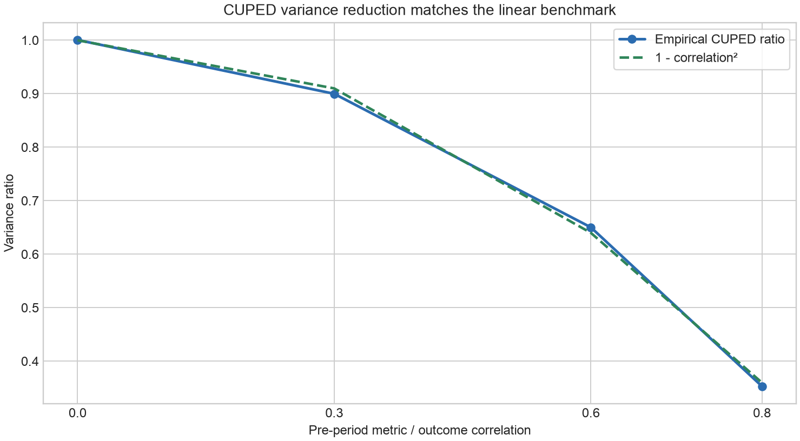

# CUPED Variance Reduction Lab

A reproducible Monte Carlo study of covariate adjustment in randomized experiments.
The project contrasts a valid pre-treatment adjustment with a tempting but invalid
post-treatment control, showing why precision and causal validity must be audited
together.

## Estimators

- **Unadjusted:** outcome regressed on treatment only.
- **CUPED / pre metric:** outcome regressed on treatment and a centered metric fixed
  before randomization.
- **Bad control / post metric:** the same regression uses a metric shifted by treatment.
  This is deliberately invalid for the total treatment effect.

All specifications use an HC1 heteroskedasticity-robust standard error. The treatment
coefficient, nominal 95% interval, coverage, power, bias, and empirical sampling
variance are evaluated independently.

## Simulation design

- 800 individually randomized units per experiment with 50/50 assignment.
- True additive treatment effect: 0.20 outcome standard deviations.
- Pre-period metric/outcome correlations: 0, 0.3, 0.6, and 0.8.
- The post metric equals the pre metric plus a 0.50 treatment shift and measurement
  noise, making it a treatment-affected bad control.
- 4,000 replications at each correlation with seed `20260929`.

The outcome variance is standardized, so the linear CUPED benchmark predicts a
variance ratio close to `1 - correlation²`. All data are deterministic synthetic
draws; no external or private data are used.

## Reproduce

```bash
python -m venv .venv
source .venv/bin/activate
python -m pip install -e ".[test]"
pytest -W error
python -m cuped_variance_reduction_lab --output-dir artifacts
```

## Results

At pre-period metric/outcome correlation 0.8, the 4,000-replication results were:

| Method | Bias | Variance ratio | 95% coverage | Zero-null rejection rate |
|---|---:|---:|---:|---:|
| Unadjusted | -0.0006 | 1.000 | 0.951 | 0.805 |
| CUPED / pre metric | **-0.0001** | **0.353** | **0.951** | **0.995** |
| Bad control / post metric | -0.3201 | 0.517 | 0.000 | 0.652 |

CUPED retained negligible bias and nominal confidence-interval coverage while cutting
variance by 64.7%. Its empirical variance ratio of 0.353 closely matched the linear
benchmark `1 - 0.8² = 0.36`. As correlation increased from 0 to 0.8, its zero-null
rejection rate rose from 80.5% to 99.5%; for this valid estimator that is a power gain.

The bad-control specification looked more precise but estimated a mean effect of
-0.120 instead of the true +0.200. Its 65.2% zero-null rejection rate at correlation
0.8 is not valid power: many rejections support the wrong direction because the
estimator is biased. At correlations 0.3, 0.6, and 0.8 its nominal 95% coverage fell
to 60.1%, 2.5%, and 0.0%, respectively. Smaller variance cannot rescue an invalid
causal adjustment.



## Outputs

- `artifacts/simulation_results.csv`: bias, empirical and estimated uncertainty,
  coverage, power, RMSE, and variance ratios.
- `artifacts/run_summary.json`: machine-readable design and headline results.
- `artifacts/variance_ratio.png`: precision of all three estimators.
- `artifacts/cuped_theory_check.png`: empirical CUPED reduction versus `1 - r²`.
- `artifacts/bias.png`: estimator bias as prognostic strength increases.
- `artifacts/coverage.png`: nominal 95% interval coverage.

## Repository structure

```text
src/cuped_variance_reduction_lab/
  simulation.py  # randomized experiment and post-treatment bad control
  estimation.py  # OLS treatment coefficient with HC1 uncertainty
  evaluation.py  # paired Monte Carlo audit and summaries
  reporting.py   # static precision and validity figures
tests/            # simulation, estimator, bias, and E2E tests
artifacts/        # reproducible outputs from the default run
```

## Limitations

- The linear Gaussian design makes the CUPED benchmark transparent but does not cover
  nonlinear outcomes, ratio metrics, attrition, or interference.
- HC1 uses a large-sample normal approximation; small experiments may need different
  randomization-based or finite-sample inference.
- The pre metric is observed without missingness and its specification is fixed.
- The bad-control example illustrates one causal failure mode; not every post-period
  variable creates the same bias.
- Power is evaluated for one effect size and allocation ratio.

## Responsible use

This is an educational portfolio project. Real experiment adjustments must be fixed
before outcome inspection and justified by the experiment's causal timeline.
